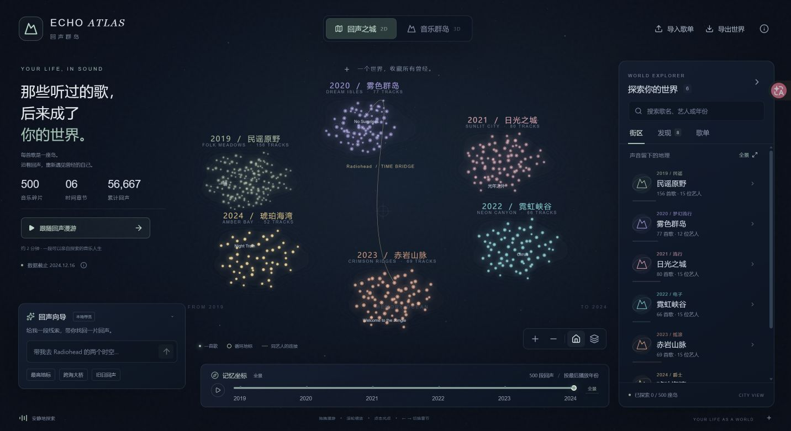
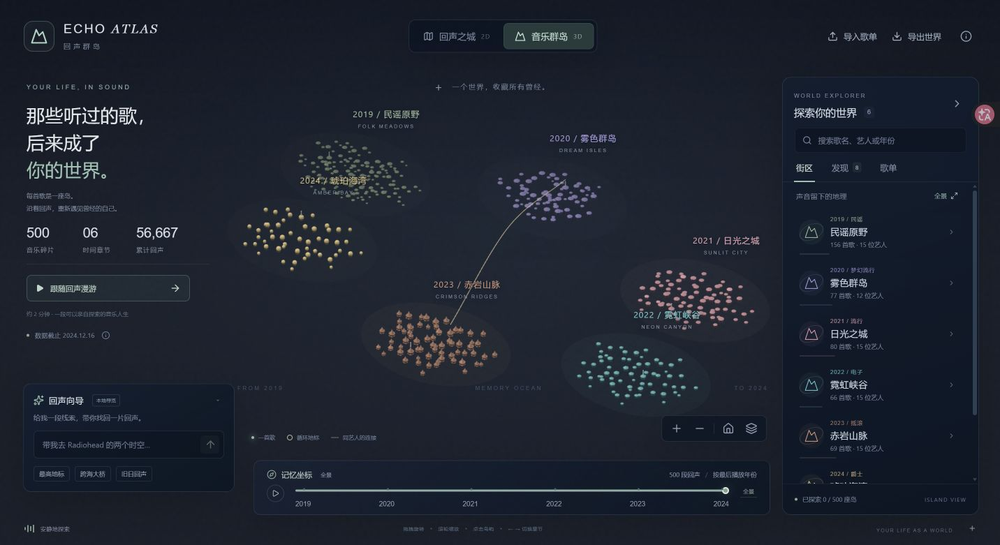

# Echo Atlas · 回声群岛

> 那些听过的歌，后来成了你的世界。

**BNBU Programming Contest · AI Track / Your Life as a World**

把歌单中的 500 个音乐碎片变成可以亲自探索的世界：一座深色发光的二维城市，以及一片可以旋转的三维群岛。每首歌是一个光点或岛屿；同一艺人的声音在空间里相聚，跨年份的声音形成桥梁，你的笔记则让统计拥有自己的故事。





## 最快开始

下载本项目的已编译交付文件夹后，双击 **启动应用.cmd**。它会打开 `http://127.0.0.1:4173`。保留启动窗口，关闭窗口即可停止应用。需要 Node.js 22.12 或更高版本；交付文件夹已包含 `dist/`，不需要安装前端依赖，不需要 API 密钥，也不需要联网。

从 GitHub 克隆源码时，先编译一次：

```sh
git clone https://github.com/11tony-code/Your-life-as-a-world.git
cd Your-life-as-a-world
npm ci
npm test
npm run build
npm start
```

开发模式：`npm run dev`，访问 `http://127.0.0.1:5173`。

如果端口占用，关闭之前的启动窗口，或在 `.env` 里设置 `PORT=4174`。本地服务器只监听 `127.0.0.1`。

## 可以做什么

- **两个世界，同一份数据**：PixiJS 绘制二维发光地图；Three.js 实例化低多边形岛屿。旋转、拖动、缩放、光点悬停、歌曲点击、镜头飞行均可操作。
- **六个时间章节**：民谣原野、雾色群岛、日光之城、霓虹峡谷、赤岩山脉、琥珀海湾。导入新年份或流派时，世界会重新生成。
- **发现与连线**：真实计算最高地标、跨年艺人、Live 双岛、旧日收藏、最新海岸和累计播放与静默时间的反差。每条发现可以查看数据依据并跳转。
- **时间切片**：过滤 `last_played` 年份上限，也可自动播放切片；这不是完整听歌历史的回放。
- **回声向导**：默认本地规则导览，可以问歌名、艺人、流派、年份、最高地标与跨海大桥；可选真实的在线大模型服务。
- **个人记忆**：每首歌可以收藏、记录笔记、查看自己的访问记录；在本机浏览器中保存，刷新后仍在。
- **听见回声**：关联自己的本地音频，在歌曲详情中播放；或打开网易云搜索。另有可关闭的程序合成环境音。
- **导入与导出**：CSV 校验、完整 JSON 备份恢复、PNG 世界明信片、CSV 原数据和 Markdown 音乐世界报告。
- **现场演示**：「跟随回声漫游」提供六站旅程；支持键盘操作、小屏布局、减少动效和 3D 不可用时切回二维地图。

## 数据说了什么

数据来自用户提供的 `playlist.csv`，作为演示歌单。其原始记录真实性未独立核验。没有声称这些日期是官方平台播放日志，也没有生成额外的真实人生经历。

| 最后播放年份 | 主导流派 | 歌曲数 | 该切片歌曲的累计次数合计 |
| --- | --- | ---: | ---: |
| 2019 | 民谣 | 156 | 9,989 |
| 2020 | 梦幻流行 | 77 | 10,914 |
| 2021 | 流行 | 80 | 11,831 |
| 2022 | 电子 | 66 | 7,628 |
| 2023 | 摇滚 | 69 | 12,167 |
| 2024 | 爵士 | 52 | 4,138 |

共 **500 首歌、86 位艺人、56,667 次累计播放**；最近的最后播放日期为 **2024-12-16**。最高地标为 Radiohead 的《No Surprises》，299 次。按同艺人与去除 Live 标记的歌名匹配，识别到 **97 对双岛**；Radiohead 是唯一跨最后播放年份的艺人，共 21 首，连接 2020 与 2023。

`play_count` 是累计次数，不能解释为该年的播放量。`last_played` 是最后播放日期，不能证明用户某年只听某流派、后来彻底离开、第一次何时听到、是否在深夜听歌或当时的情绪。颜色、地形和气候是艺术映射。默认亮度相对数据截止日，数据说明中也可改为相对今天。

完整算法与取舍见 [设计与数据映射](docs/DESIGN.md)。

## 导入自己的歌单

点击右上角「导入歌单」，选择 UTF-8 CSV，或直接粘贴文本，使用下面五列：

```csv
title,artist,genre,play_count,last_played
光,陈粒,民谣,154,2019-09-08
No Surprises,Radiohead,梦幻流行,299,2020-11-07
```

支持 BOM、引号、逗号、跨行歌名与 CRLF。日期必须是有效的 `YYYY-MM-DD`，累计次数是非负整数。每次最多 5,000 条、文件不超过 5 MB；无效行会跳过并显示报告，完全重复的记录会去重。未知流派仍可生成世界。导入和笔记在浏览器本地处理，不会上传。

从原始 CSV 重新生成源码内数据：`npm run data`。

导出 JSON 备份后，通过同一个导入按钮恢复歌单、笔记与收藏。音频只用于当前会话，不包含在 JSON 备份中；歌曲笔记最多 1,500 字。

## 可选在线 AI

默认导览没有调用模型，界面明确标为「本地导览」。如果希望连接大模型：

1. 复制 `.env.example` 为 `.env`，在**服务端**填写 `AI_API_KEY`、`AI_BASE_URL`、`AI_MODEL`。
2. `npm start` 或 `npm run dev` 启动 Node 服务。
3. 回声向导中开启「使用在线 AI」。开启时会明确提示将问题和歌单摘要发送给配置的模型服务。

接口兼容 OpenAI 风格的 `/chat/completions`，默认配置地址为 DeepSeek。每次最多发送 60 条歌曲摘要及汇总，笔记和音频不发送。密钥不会进入浏览器、`dist/`、Git 或导出备份。模型只可返回摘要中已有歌曲、艺人或年份的导航目标；超时、未配置或服务错误时保留本地导览，并标明回退。由于没有提供模型密钥，交付验证没有进行付费的真实模型调用。

## 发布

源码包含自动测试 / 编译的 GitHub Actions。编译产物可从 CI 的 `echo-atlas-web` artifact 下载。

GitHub Pages 发布工作流只在手动点击时运行：仓库 Settings → Pages → Source 选择 GitHub Actions，再运行 Actions 中的 **Publish to GitHub Pages (manual)**。静态托管可用两种世界、本地导览、导入与备份；在线模型需要另行运行 Node 服务。没有将密钥放入 Pages 的设计。

也可把 `dist/` 放到任何静态服务器的子路径；资源使用相对路径。请通过 HTTP 打开，直接双击 `dist/index.html` 不支持 ES 模块加载。

## 结构

```text
src/
  App.jsx                 界面、选择与记忆状态
  components/             向导与可访问弹窗
  data/engine.js          CSV 校验、布局、发现、规则导览
  data/playlist.json      原始 CSV 转换后的数据
  data/storage.js         本地存储与导出
  world/World2D.jsx       PixiJS 发光城市
  world/World3D.jsx       Three.js 实例化群岛
server/                   本地生产服务器、可选模型代理
scripts/                  数据转换与一键启动
tests/                    数据与接口测试
docs/                     提交说明、演示脚本、验证记录
screenshots/              实际浏览器截图
playlist.csv              用户提供的源歌单
启动应用.cmd               Windows 启动入口
```

## 比赛提交材料

- [提交说明与相近作品对比](docs/SUBMISSION.md)
- [两分钟现场演示脚本](docs/DEMO.md)
- [设计与技术取舍](docs/DESIGN.md)
- [验证结果与适用边界](docs/VERIFICATION.md)
- [开源依赖说明](THIRD_PARTY_NOTICES.md)

项目由 Codex 辅助实现；所有地图、地形、图标组合与明信片均通过代码生成，没有复刻已有作品的角色或世界设定。比赛前已有材料与比赛期间新增工作应按团队实际情况声明，见提交说明。

## 参考

- [赛题与细则](https://ai.bnbuacm.xyz/#guide)、[Your Life as a World](https://ai.bnbuacm.xyz/#life-as-a-world)
- [用户提供的 UI 方向](https://chat.deepseek.com/share/ms9ulkrebm9hlqkdep)
- [Spotify Wrapped](https://support.spotify.com/uk/article/spotify-wrapped/)
- [Obscurify](https://www.obscurifymusic.com/)

代码采用 MIT License。歌单仅含元数据，未包含或分发任何歌曲音频。
